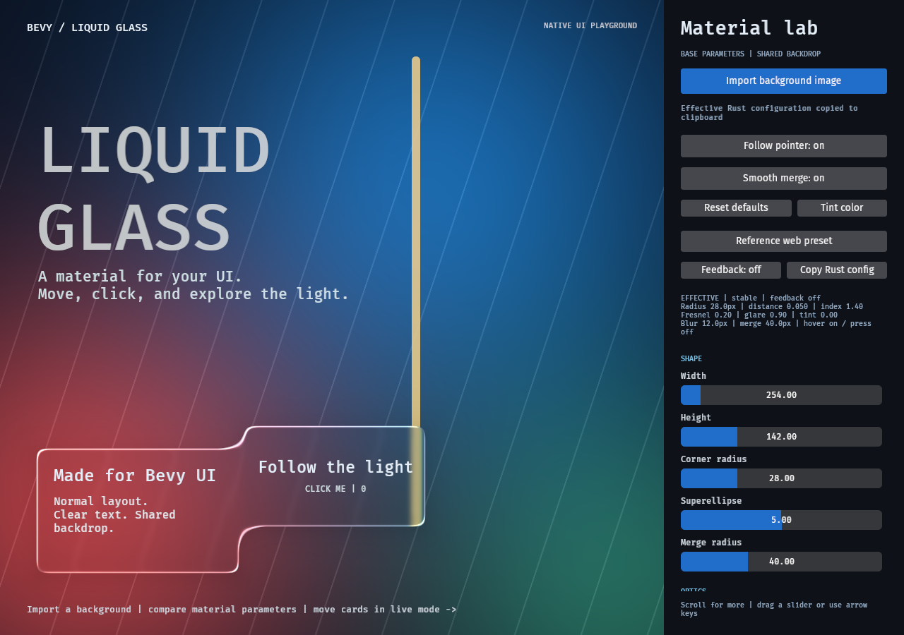

# Bevy Liquid Glass

Liquid glass for **Bevy 0.20.1 UI** with shared live backdrops, refraction,
dispersion, Fresnel, glare, tint, shadows and smooth blob groups. The library
uses a [public Bevy fork](https://github.com/shengyusi-SYS/bevy/tree/b4b5717b05ee3c8580826ce2514cf47642a8e422)
for native UI backdrop capture.



## Run the examples

Use Rust 1.97.1 or newer. On Ubuntu or Debian, install the ALSA, Wayland and
XKB development packages (`libasound2-dev`, `libwayland-dev` and `libxkbcommon-dev`).
From the repository root, run:

```sh
cargo run --locked --example minimal
cargo run --locked --example ui_panel
```

On WSLg, `./examples/preview.sh` selects D3D12 through OpenGL and X11.
Run `./examples/preview.sh minimal` for the smaller example. The panel launcher
also enables the local BRP bridge described below. Both examples cap the
preview at 30 FPS.

`ui_panel` provides image import (button, file drop or `--image`), pointer
following, merging, live parameters and a **Copy Rust config** button. Optical
interaction feedback starts **off**, independently of following and merging.
Advanced controls expose the remaining optical settings. The panel shows base
parameters and a separate readout of effective values when feedback is enabled.
`minimal` demonstrates an independent surface and a group using ordinary UI.

The reference preset uses a wide stationary bar with `OriginalCanvas` lighting.
Both the reference preset and Reset keep the imported background. Pass
`-- --reference` or `-- --image /path/to/background.png` when launching the panel
to select a starting preset or image.

## Use in a Bevy application

Add the Git dependency alongside Bevy in your application manifest.

```toml
[dependencies]
bevy = { version = "=0.20.1", default-features = false, features = ["bevy_winit", "default_font", "x11", "wayland"] }
bevy_liquid_glass = { git = "https://github.com/shengyusi-SYS/bevy_liquid_glass_studio.git", tag = "v0.1.0" }
```

Copy the complete `[patch.crates-io]` section from [Cargo.toml](Cargo.toml)
to the root of your workspace. Cargo reads patches from that workspace root.
The patch selects the same Bevy source for your app and its dependencies. The
fork provides `UiPassSegments` for capturing between native UI draws.

Install `LiquidGlassPlugin` after Bevy's normal plugins and attach
`GlassBackdrop` to the UI camera. The library embeds its shaders. See
[the minimal example](examples/minimal.rs) for a runnable example from this repo.

```rust,no_run
use bevy::prelude::*;
use bevy_liquid_glass::{
    GlassBackdrop, GlassGroup, GlassMember, GlassNode, GlassShape, GlassStyle,
    LiquidGlassPlugin,
};

fn main() {
    App::new()
        .add_plugins((DefaultPlugins, LiquidGlassPlugin))
        .add_systems(Startup, setup)
        .run();
}

fn setup(mut commands: Commands) {
    commands.spawn((Camera2d, GlassBackdrop::default()));

    // Draw scene/background UI before glass surfaces.
    commands.spawn((
        Node { width: percent(100), height: percent(100), ..default() },
        BackgroundColor(Color::srgb(0.15, 0.3, 0.45)),
    ));

    // Independent surface: all shape and optical fields apply.
    commands.spawn((
        Node { width: px(320), height: px(180), ..default() },
        GlassNode {
            shape: GlassShape { corner_radius: 28.0, ..default() },
            style: GlassStyle { refraction_distance: 0.05, ..default() },
        },
    ));

    // The group owns optics; members provide geometry only.
    commands.spawn((Node::default(), GlassGroup::default()))
        .with_children(|parent| {
            parent.spawn((
                Node { width: px(160), height: px(80), ..default() },
                GlassMember::default(),
            ));
        });
}
```

| Type | Responsibility |
|---|---|
| `GlassNode { shape, style }` | Independent surface, including inside a group container |
| `GlassMember { shape }` | Geometry fused by its nearest ancestor `GlassGroup` |
| `GlassGroup { style, blend_radius }` | Shared optics and fusion radius for its members |
| `GlassShape` | Corner radius and superellipse exponent |
| `GlassStyle` | Refraction, dispersion, Fresnel, glare, tint, shadow and lighting mode |
| `GlassBackdrop` | Per-camera source image and shared blur radius |

A `GlassMember` needs a group ancestor to render. To make it independent,
replace it with `GlassNode`. Ordinary text/buttons remain normal child UI.
The group draws its union behind member content; background UI belongs before
the group container. Each group fuses up to `MAX_GLASS_GROUP_NODES` (64);
additional members render individually with the group's style.

Shape lengths, edge thickness, blur, shadows and blend radius use logical
pixels; glare angle uses degrees. `refraction_distance` preserves the original
**dimensionless** value. Fresnel/glare ranges retain the original tuning units.
Tint alpha controls coloring, rather than surface coverage.

`GlassLighting::Stable` is the default: lighting and logical edge feathering
stay consistent across window resizing and DPI changes, calibrated at 900px.
`OriginalCanvas` preserves the upstream dependence on physical canvas height
for source comparisons. Changing this mode does not change refraction units.

## Tune, copy and debug

**Copy Rust config** exports the currently rendered shape, optical style,
backdrop blur, group and member as compilable Rust. It includes feedback state
in comments, so temporary hover effects are distinguishable from base values.
The generated function can be pasted into an application; layout and background
selection remain with that application.

Run `cargo run --locked --example ui_panel --features ui-debug` to enable the
example's BRP bridge on `127.0.0.1:15704`. The Bash panel launcher also enables
this feature.

```sh
python3 examples/ui_debug.py settings
python3 examples/ui_debug.py set style.glare_strength 0.13
python3 examples/ui_debug.py set shape.corner_radius 22
python3 examples/ui_debug.py set feedback false
python3 examples/ui_debug.py snapshot
python3 examples/ui_debug.py find FollowGlass
python3 examples/ui_debug.py config /tmp/glass_config.rs
python3 examples/ui_debug.py move 420 360
python3 examples/ui_debug.py image /absolute/path/to/background.png
python3 examples/ui_debug.py capture /tmp/liquid-glass.png
```

The panel and BRP share the reflected `ui_panel::PreviewSettings` resource.
`set` calls official `world.mutate_resources`; `settings` calls
`world.get_resources`. Preview components are rendered projections of that
resource. Snapshot includes structured shape/style values, group ownership,
and base/effective preview settings. `rpc` exposes the other standard BRP
methods. Input coordinates are logical pixels; snapshot geometry is physical.
The core library needs neither BRP, Feathers, a file picker nor clipboard access.

## Rendering contract

The first visible glass surface captures preceding scene/UI once. Other
surfaces on that camera share the snapshot and blur. Foreground stays sharp;
later surfaces share the capture rather than recursively sampling earlier glass.
`GlassBackdrop.source` can supply an existing full-target `Handle<Image>`.

For static backgrounds, set `refresh: GlassBackdropRefresh::OnDemand` on the
camera's `GlassBackdrop`. The library caches the shared result until its settings,
source Image asset, target size/DPI/viewport or GPU textures change. After updating
captured scene/UI content or writing the source Image on the GPU, request a refresh
with normal Bevy change detection:

```rust
fn background_changed(mut backdrops: Query<&mut GlassBackdrop>) {
    for mut backdrop in &mut backdrops {
        backdrop.set_changed();
    }
}
```

The default `EveryFrame` policy supports animated backgrounds. Moving glass nodes
and changing their styles do not require refreshing a static background.
Independent nodes with the same effective configuration share immutable material
assets; changing one node's style switches its binding without modifying others.
Native UI ordering still determines which draws can batch.

Independent nodes use Bevy's normal `BoxShadow`. The fork automatically caches
stable or repeated soft-shadow coverage by physical size, corners, blur and sample
count; position and color changes reuse the mask. The default mask budget is
32 MiB and unused entries expire after three frames. Native clipping and draw
order are preserved; adjacent compatible shadows can batch. The masks use R8
coverage and linear filtering, so subpixel results can differ from analytic
shading. For direct analytic comparisons, set `enabled: false` in Bevy's optional
`BoxShadowCacheSettings` resource. Hard shadows, sample counts below four and
shapes exceeding the budget keep the analytic path. No glass configuration changes
are required. Fused groups keep their own silhouette shading and skip distant
members that cannot affect the current union distance.

`GlassBackdrop.blur_quality` defaults to `GlassBlurQuality::Auto`: radii below
8 physical pixels use full resolution, larger radii use half-width/half-height
blur textures. Choose `HalfResolution` to use half-width/half-height blur textures
at any positive radius, independently of blur strength. For example, radius 5 can
stay 5 while the blur runs at half size. This is an approximation: fine details
and moving edges can differ. Raw refraction and foreground UI stay full resolution.
The half-size path prefilters in the reference sRGB working space before the two
Gaussian passes, avoiding brightening dense details. This also applies when Auto
selects half size. At 4K, its three intermediate textures total about 47.5 MiB,
compared with 126.6 MiB for the two full-size blur textures; raw capture is separate.
Choose `FullResolution` for exact convolution comparisons; the reference preset
does this automatically. Radius zero aliases the blurred input to the raw image
and skips both blur passes in every quality mode.

The preview's **Blur quality** button cycles Auto / Half / Full. The selection is
also available through BRP and included in **Copy Rust config**:

```sh
python3 examples/ui_debug.py set blur_quality '"HalfResolution"'
```

With `ui-debug`, launch with `GLASS_RENDER_DIAGNOSTICS=1` to collect Bevy render
diagnostics, then read them with `python3 examples/ui_debug.py rpc glass/diagnostics`.
Profiling is off during ordinary preview use. For comparisons with GPU completion,
launch with `GLASS_SYNC_BENCHMARK=1 ./examples/preview.sh`. It reports 120-frame
averages after warmup, synchronizing GPU completion each frame. This measures
CPU plus GPU completion before presentation and the frame cap, and changes
normal GPU pipelining; leave it off for ordinary preview use.

For scalable development workloads, reuse the same preview:

```sh
./examples/preview.sh -- --nodes 1000 --on-demand
./examples/preview.sh -- --nodes 1000 --groups 16 --animate-load --on-demand
python3 examples/ui_debug.py rpc glass/stats
python3 examples/ui_debug.py set load_nodes 1000
python3 examples/ui_debug.py set load_groups 16
python3 examples/ui_debug.py rpc world.mutate_resources '{"resource":"bevy_liquid_glass::GlassStatistics","path":"collect_timings","value":true}'
```

`GlassStatistics` reports cumulative node/group rebuilds, live shared material
count, and background processing across active cameras. Optional CPU timings
(`*_sync_us`) report the latest system sample in microseconds; collection defaults
to off. `--animate-load` moves only the first node, useful for checking local
updates in a mostly static interface. Reset/reference presets return to the normal
two-surface example. Per-group fusion capacity and the total UI node count are
separate dimensions; the load controls can exercise both.

The native SDR implementation supports sRGB/linear compositing. Apply group
clipping on the group or an ancestor; groups support axis-aligned translation
and scaling. Independent branch clips and rotated members are outside the
current group contract. Web deployment, HDR and recursive captures are later
work. The library leaves application frame pacing alone.

For this Bevy/wgpu version, WSLg's GL display initialization is isolated in
[the example support module](examples/support/native_gl.rs). It passes Winit's
owned display to the fork's automatic renderer; Bevy chooses the adapter,
features and device limits. Applications using that backend can reuse it.

## Development

See the [architecture](docs/architecture.md) for the rendering stages and
module boundaries. Check the library and examples with:

```sh
cargo fmt --all -- --check
cargo check --locked --lib --examples --features ui-debug
```

The native preview was exercised on WSLg. Compile checks cover the library and
examples on Linux.

## License

Original library code is available under the MIT license. The optical/SDF/color
model is adapted from
[iyinchao/liquid-glass-studio](https://github.com/iyinchao/liquid-glass-studio)
(MIT). UI phase capture is adapted from
[Beverly](https://github.com/AllTheCodeThatVictorWroteInBali/beverly)
(Apache-2.0). See [LICENSE](LICENSE), [NOTICE](NOTICE) and
[THIRD_PARTY_LICENSES](THIRD_PARTY_LICENSES).
