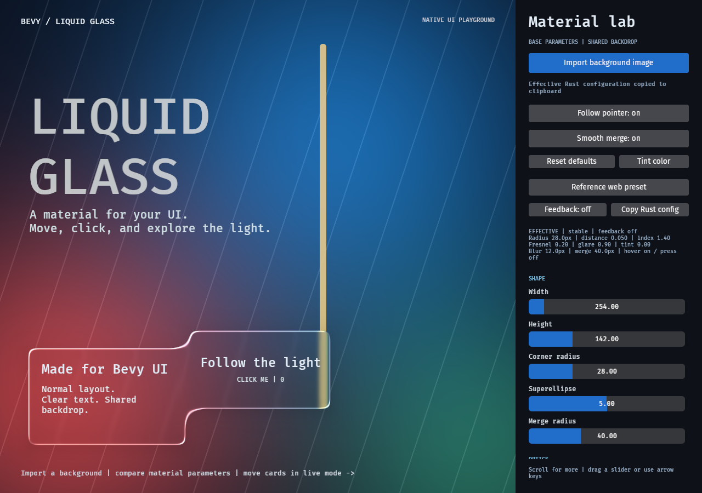

# Bevy Liquid Glass

[English](README.md) · 简体中文

适用于 Bevy UI 的液态玻璃库，支持共享实时背景、折射、模糊和形状融合。



## 运行示例

需要 Rust 1.97.1 或更高版本。Ubuntu 或 Debian 下需安装 `libasound2-dev`、
`libwayland-dev` 和 `libxkbcommon-dev`。在仓库根目录运行示例。

```sh
cargo run --locked --example ui_panel
cargo run --locked --example minimal
```

`ui_panel` 支持导入背景、实时调参和复制 Rust 配置。
在 WSLg 上，使用 `./examples/preview.sh --locked` 可通过 OpenGL 和 X11 使用 D3D12。

## 接入应用

使用锁定版本的 [Bevy 0.20.1 fork](https://github.com/shengyusi-SYS/bevy/tree/b4b5717b05ee3c8580826ce2514cf47642a8e422)。
该 fork 提供 `UiPassSegments`，供库在两段 UI 绘制之间捕获背景。

```toml
[dependencies]
bevy = { version = "=0.20.1", default-features = false, features = ["bevy_winit", "default_font", "x11", "wayland"] }
bevy_liquid_glass = { git = "https://github.com/shengyusi-SYS/bevy_liquid_glass_studio.git", tag = "v0.1.0" }
```

将 [Cargo.toml](Cargo.toml) 中的完整 `[patch.crates-io]` 配置复制到工作区根 manifest，
让应用与库使用同一份 Bevy 源码。

1. 在 Bevy 的 `DefaultPlugins` 之后添加 `LiquidGlassPlugin`。
2. 给 UI 相机添加 `GlassBackdrop`。
3. 给 UI 节点添加 `GlassNode`。要融合形状，将 `GlassMember` 节点放在 `GlassGroup` 下。

完整的可运行配置见仓库内的[最小示例](examples/minimal.rs)。

## 渲染行为

- 每台相机在绘制第一个可见玻璃表面之前捕获场景和已绘制的 UI。同一相机上的玻璃共享这份背景，
  之后绘制的 UI 保持清晰。也可以通过 `GlassBackdrop.source` 指定一张与渲染目标等大的图像。
- 背景默认逐帧刷新。静态背景可使用 `GlassBackdropRefresh::OnDemand`，更改场景或 UI，
  或通过 GPU 写入源图像后，将 `GlassBackdrop` 标记为已更改。
- 库面向原生 SDR UI。玻璃组支持平移和轴对齐缩放，并继承组容器或其祖先的裁剪。

模糊分辨率、分组限制和坐标单位见[架构说明](docs/architecture.md)。

## 调试预览

运行 `cargo run --locked --example ui_panel --features ui-debug`，
可在 `127.0.0.1:15704` 启用本地 BRP 调试接口。
检查状态和截图等命令见 `python3 examples/ui_debug.py --help`。

## 许可证

库的原创代码采用 MIT 许可证。光学效果改编自
[Liquid Glass Studio](https://github.com/iyinchao/liquid-glass-studio)（MIT），
UI 捕获改编自 [Beverly](https://github.com/AllTheCodeThatVictorWroteInBali/beverly)（Apache-2.0）。
详见 [LICENSE](LICENSE)、[NOTICE](NOTICE) 和 [THIRD_PARTY_LICENSES](THIRD_PARTY_LICENSES)。
